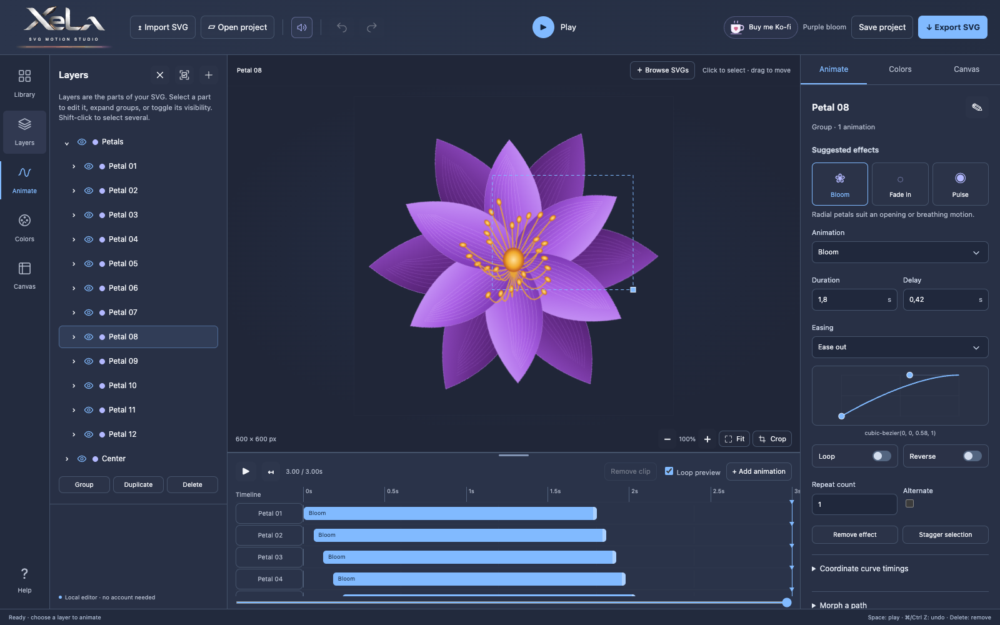

# SVG Motion Studio

Turn still SVG illustrations into animations—without writing code. Choose artwork, add movement, adjust the timing, and download your finished SVG.

**[Open the editor](https://gxella.github.io/svg-motion-studio/)** — no account or installation needed.

## Make your first animation

1. **Choose an SVG.** Click **Browse SVGs** to explore the built-in collection, or drag your own SVG file into the editor.
2. **Select what should move.** Click a shape in the picture or choose it in **Layers**. Expand a group to select its individual parts.
3. **Add an effect.** Open **Animate** and try Fade in, Bloom, Reveal, Rotate, or another suggested effect.
4. **Make it yours.** Adjust duration for speed and delay for when it starts. Press **Play** to preview; enable **Loop** to repeat the effect.
5. **Download it.** Click **Export SVG** and choose **Animated SVG**.

## More ways to create

- Browse **139 built-in artworks**, or search online icons through Iconify.
- Animate separate shapes and combine effects using the timeline at the bottom.
- Change fills, outlines, gradients, and palettes in **Colors**.
- Adjust dimensions in **Canvas**, or enter a custom ratio such as **16:9** or **4:5**. **Reset** restores the original imported dimensions.
- Use **Undo** if you change your mind. To remove only an animation, select its timeline clip and press Delete or Backspace.
- Mute click sounds with the speaker button at the top.

## Save your work

**Save project** downloads an editable project you can reopen later with **Open project**. Keep this file if you want to continue editing—an exported SVG is the finished artwork, not the full editor project.

The editor also autosaves in your browser, but browser data can be cleared. Download your project to keep a reliable copy.

## A few useful tips

- This editor works with **SVG files**, not JPG or PNG photos.
- Copying an icon from Iconify? Choose **Copy SVG**, then paste into the editor. HTML containing an actual SVG works too; a link or embed alone does not.
- Imported self-contained SVGs work offline. To use the editor offline, download this repository as a ZIP, extract it, and open `index.html`. Keep its folders together. Searching online icons still needs internet.
- Open exported animations in a browser. Some image viewers and websites show SVGs as still images. GIF and video export are not supported.
- Artwork permissions vary. Check the relevant license before sharing or using an illustration commercially.

Need more help? Open **Help** inside the editor or read the [full user guide](docs/user-guide.md).

[Support the project on Ko-fi](https://ko-fi.com/x_e_l_a) · [License and artwork permissions](LICENSE.txt) · [Developer documentation](docs/development.md)
